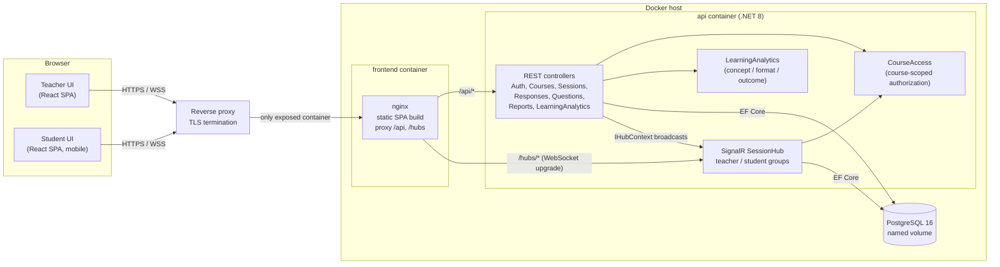
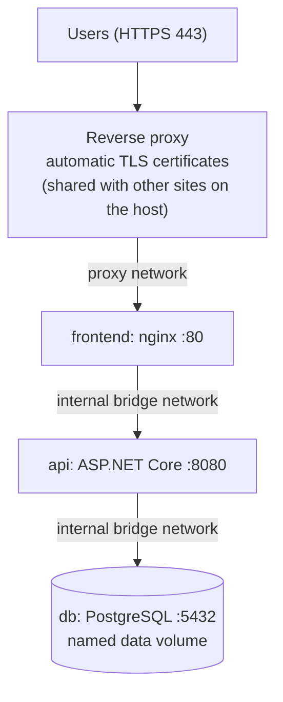

# Architecture (v2.2.1)

## Stack and versions

| Layer | Technology | Version |
|---|---|---|
| Backend | ASP.NET Core, clean-architecture layout (Domain / Infrastructure / API) | .NET 8 (`net8.0`) |
| ORM | Entity Framework Core + Npgsql provider | 8.0.4 |
| Identity | ASP.NET Core Identity (users and roles stored in PostgreSQL), JWT Bearer authentication (HMAC-SHA256) | 8.0.4 |
| Real time | ASP.NET Core SignalR (WebSocket), hub at `/hubs/session`; Microsoft SignalR JavaScript client | server: .NET 8; client ^10.0.0 |
| Frontend | React single-page application, React Router | React ^19.2.4, react-router-dom ^7.13.2 |
| Build / CSS | Vite, Tailwind CSS | Vite ^8.0.1, Tailwind ^4.2.2 |
| Other client libraries | axios (HTTP), d3-cloud (word cloud) | ^1.14.0, ^1.2.9 |
| Database | PostgreSQL | 16 (`postgres:16-alpine`) |
| Containers | Docker, multi-stage images: API `dotnet/sdk:8.0 → dotnet/aspnet:8.0` (port 8080); frontend `node:22-alpine → nginx:alpine` (port 80) | — |
| Reverse proxy | A TLS-terminating reverse proxy in front of the frontend container (Traefik v3 in the studied deployment); the frontend's nginx forwards `/api/` and `/hubs/` to the API | — |
| Tests | xUnit + EF Core InMemory | xUnit 2.9.2; 105 tests at v2.2.1 |

There is no CI/CD pipeline. Images are built on a workstation, pushed to a
container registry and pulled on the server. There is no staging environment.

## Components



- The hub contains no business logic. All state changes go through REST
  endpoints, which then broadcast through `IHubContext<SessionHub>`.
- Answers are evaluated on the server only. The answer key is never sent to students
  before a run closes.
- The API applies EF Core migrations and seeds the roles (Admin, Teacher, Student)
  on startup.

## Live-session flow

```mermaid
sequenceDiagram
    autonumber
    actor Tch as Teacher
    participant API as API (REST)
    participant Hub as SessionHub
    participant DB as PostgreSQL
    actor Stu as Student

    Tch->>API: POST /api/sessions (Draft, 6-char JoinCode + QR)
    Tch->>API: POST /api/sessions/{id}/start (Draft → Active)
    Tch->>Hub: JoinSession(id) → teacher group (after course check)
    Stu->>API: POST /api/sessions/join {JoinCode} (enrollment check)
    API->>DB: insert SessionParticipant (join time, method, IP)
    API-->>Hub: ParticipantJoined → teacher group
    API-->>Stu: session info + currently open question (if any)
    Stu->>Hub: JoinSession(id) → student group

    Tch->>API: POST .../question-runs/{runId}/open
    API->>DB: close any other open run; Status = Open; OpenedAt = server UTC now
    API-->>Hub: QuestionOpened (prompt + options, no answer key) → both groups
    Hub-->>Stu: QuestionOpened

    Stu->>API: POST /api/responses
    Note over API: checks run Open, active enrollment,<br/>one response per student and run
    API->>DB: insert Response (SubmittedAt = server UTC now, IsCorrect) + ScoreEvents
    API-->>Hub: ResponseReceived, ScoresUpdated → teacher group only
    API-->>Stu: result (correct / incorrect, points)

    Tch->>API: POST .../question-runs/{runId}/close
    API->>DB: Status = Closed; ClosedAt
    API-->>Hub: QuestionClosed (+ correct options) → both groups

    Tch->>API: POST /api/sessions/{id}/close
    API->>DB: close open runs; Session → Closed; EndedAt
    API-->>Hub: SessionClosed → both groups
```

Notes:

- At most one run is open per session. Opening a run closes any other open run.
- `TimeLimitSeconds` is advisory. The student screen shows it as a static label,
  nothing closes the run automatically, and the server accepts answers until the
  teacher closes it. It is only used to compute the optional speed bonus.
- Retries are not possible. A unique index on (run, student) enforces one answer
  per student per run, and a second submission returns HTTP 409.

## Deployment model (generic)



- There are three application containers (db, api, frontend) defined in one compose file. The
  reverse proxy is an external, pre-existing container.
- Only the frontend joins the proxy network. The API and the database publish no host
  ports and are reachable only on the internal network.
- Only the database has persistent storage, in one named volume.
- In the studied deployment, the host is a rented virtual machine (2 vCPU, 2 GB
  RAM) that also runs other services. Its older kernel required running the API
  container with a relaxed seccomp profile.
- Updates are manual: pull the new images, then recreate the api and frontend containers.
  Each update causes a short downtime.
- Swagger/OpenAPI is enabled only in development.
- The only external service the backend calls is an SMTP server, for account-recovery
  e-mails. The frontend loads no analytics or telemetry SDKs.
