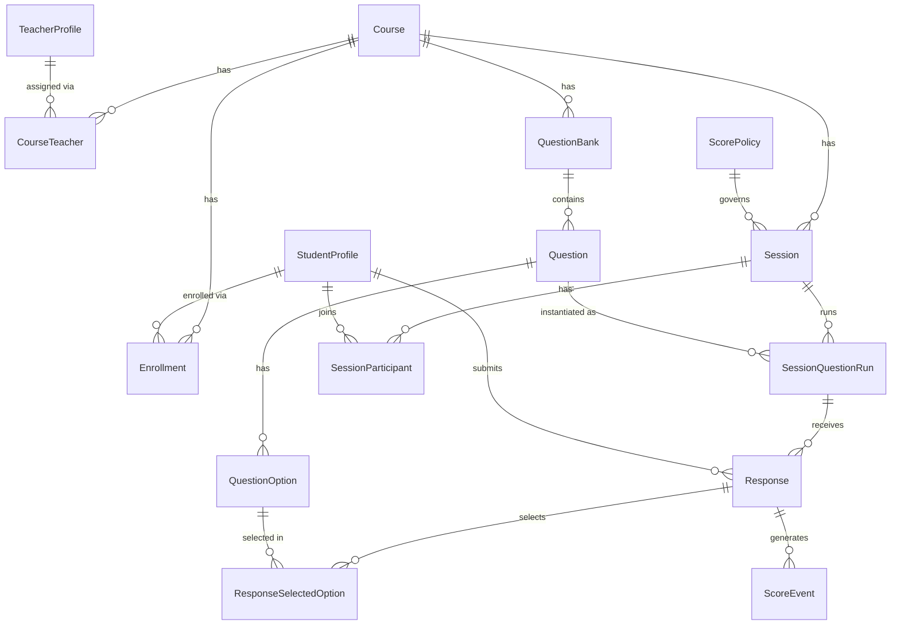

# Data model (v2.2.1)

The model is defined with EF Core 8 on PostgreSQL 16. Every entity except the join
tables inherits `Id : uuid` (primary key) and `CreatedAt : timestamp (UTC)`.
PostgreSQL table names are in brackets. Enums are stored as text unless noted.

## Entities and relevant columns

### Course `[Courses]`
| Column | Type | Notes |
|---|---|---|
| Code | text, required | Institutional course code |
| Name | text, required | |
| Term | text, required | Academic term, e.g. `2026-2`. A course **offering** is one (Code, Term) row |
| Career | text, optional | Degree program (added in v2.2) |
| Description | text, optional | |
| IsActive | bool | |

Teachers are assigned through `CourseTeacher [CourseTeachers]` (composite PK
`CourseId, TeacherId`).

### TeacherProfile `[Teachers]`
`UserId` (unique), `FirstName`, `LastName`, `InstitutionalEmail`.

### StudentProfile `[Students]`
| Column | Type | Notes |
|---|---|---|
| UserId | uuid | **Unique**; same id as the Identity user |
| StudentCode | varchar(50), required | **Unique**; institutional student code |
| FirstName, LastName | varchar(100), required | |
| InstitutionalEmail | varchar(200), required | Self-registration requires an address ending in `.edu.pe` |
| Career, Section | text, optional | |
| IsActive | bool | False until an administrator approves the registration |
| RequestedCourseId | uuid, optional | Course chosen at self-registration; the student is enrolled in it on approval |

### Enrollment `[Enrollments]`
`CourseId`, `StudentId`, `Status` {Active, Inactive, Dropped}, `EnrolledAt`.
**Unique (CourseId, StudentId).**

### Session `[Sessions]`
| Column | Type | Notes |
|---|---|---|
| CourseId, TeacherId | uuid, required | |
| ScorePolicyId | uuid, optional | |
| Title | varchar(200) | |
| Status | {Draft, Active, Closed, Cancelled} | |
| JoinCode | varchar(10), **unique** | Generated as 6 characters from an unambiguous alphabet (no 0/O, 1/I) |
| StartedAt, EndedAt | timestamp, optional | Written when the teacher presses Start / Close |

### QuestionBank `[QuestionBanks]`
`CourseId` (optional), `CreatedByTeacherId`, `Name`, `Description`.

### Question `[Questions]`
| Column | Type | Notes |
|---|---|---|
| QuestionBankId, CourseId | uuid, optional | |
| CreatedByTeacherId | uuid | |
| Title | varchar(300) | |
| Prompt | text | |
| QuestionType | {SingleChoice, MultipleChoice, TrueFalse, ShortText, Likert, WordCloud} | Likert exists in the enum but not in the editor |
| HasCorrectAnswer | bool | False for word cloud and short text |
| IsActive | bool | Delete is a soft delete. Inactive questions keep their responses in the analytics |
| **Topic** | varchar(100), optional | Pedagogical metadata (unit / week) |
| **ConceptTag** | varchar(100), optional | Pedagogical metadata (concept) |
| **LearningOutcome** | varchar(250), optional | Pedagogical metadata (outcome / achievement indicator) |
| UpdatedAt | timestamp | |

Options are stored in `QuestionOption [QuestionOptions]`: `QuestionId`, `OptionText`, `OptionOrder`,
`IsCorrect`, `Weight`. `Weight` is stored but not used.

### SessionQuestionRun `[SessionQuestionRuns]`
One instance of a question inside a session.

| Column | Type | Notes |
|---|---|---|
| SessionId, QuestionId | uuid | |
| DisplayOrder | int | |
| Status | {Pending=0, Open=1, Closed=2, Evaluated=3}, **stored as integer** | |
| TimeLimitSeconds | int, optional | Advisory; used only for the optional speed bonus |
| AllowRetry | bool | Stored but has no effect (see the unique index on Response) |
| **OpenedAt** | timestamp, optional | Server UTC time when the teacher's open request is processed |
| ClosedAt | timestamp, optional | |
| ManualCloseByTeacherId | uuid, optional | |

### Response `[Responses]`
| Column | Type | Notes |
|---|---|---|
| SessionQuestionRunId | uuid | |
| SessionId, QuestionId | uuid | Denormalized |
| StudentId | uuid | |
| **SubmittedAt** | timestamp | Server UTC time when the submission is processed |
| ResponseText | text, optional | Word cloud / short text |
| SelectedOptionId | uuid, optional | Single choice / true-false |
| IsCorrect | bool, optional | Null = not evaluable |
| EvaluationStatus | {Pending, Correct, Incorrect, NotApplicable} | |
| **RawPayloadJson** | text, optional | Full request body as submitted |

**Unique (SessionQuestionRunId, StudentId)**: one response per student per run.
Multiple-choice selections are stored in `ResponseSelectedOption [ResponseSelectedOptions]`
(composite PK `ResponseId, OptionId`).

### SessionParticipant `[SessionParticipants]`
`SessionId`, `StudentId`, `JoinedAt`, `LastSeenAt`, `JoinMethod` {QrCode, ManualCode},
`DeviceInfo` (never populated), **`IpAddress`** (varchar(45)).
**Unique (SessionId, StudentId).**

### Scoring
- `ScorePolicy [ScorePolicies]`: participation, correct and incorrect points, plus an optional speed bonus.
- `ScoreEvent [ScoreEvents]`: an append-only ledger of point changes per response.
- `ScoreSummary [ScoreSummaries]`: a denormalized per-course total derived from the ledger.

### Accounts
- The ASP.NET Core Identity tables (`AspNetUsers`, `AspNetRoles`, …) hold the login
  account. `AspNetUsers.RegistrationStatus` is {Pending=0, Active=1, Rejected=2},
  **stored as integer**.
- `User [DomainUsers]` mirrors the Identity user with the same id.
- Roles: Admin, Teacher, Student.

## Relationships

Required foreign keys cascade on delete.

## Unique constraints (database level)

| Table | Unique key |
|---|---|
| Responses | (SessionQuestionRunId, StudentId) |
| Enrollments | (CourseId, StudentId) |
| SessionParticipants | (SessionId, StudentId) |
| Sessions | JoinCode |
| Students | StudentCode; UserId |
| Teachers | UserId |
| CourseTeachers / ResponseSelectedOptions | composite primary key |
| AspNetUsers / AspNetRoles | normalized user name / role name (Identity defaults) |

(Code, Term) on `Courses` is unique **only in application code** (the course
create/update endpoints). There is no database index for it.

## Personal data stored

| Field | Table | Purpose |
|---|---|---|
| First and last name | Students, Teachers | Identification in teacher views and exports |
| Student code | Students.StudentCode | Institutional identity; enrollment lookup |
| Institutional e-mail | Students, Teachers, AspNetUsers | Login, account recovery, exports |
| Career, section | Students | Optional profile data |
| IP address at session join | SessionParticipants.IpAddress | Recorded on `POST /api/sessions/join`; not used by any feature |
| Raw request body per response | Responses.RawPayloadJson | Copy of the submitted payload (run id, selected option ids, text) |
| Free-text answers | Responses.ResponseText | Word cloud / short text |
| Timestamps of activity | Responses.SubmittedAt, SessionParticipants.JoinedAt/LastSeenAt | Response time; attendance |

At v2.2.1 there is no retention policy, and CSV exports (session responses,
course points matrix, ranking) contain student code, full name and e-mail in clear
text. The learning-analytics endpoints return aggregates only.
